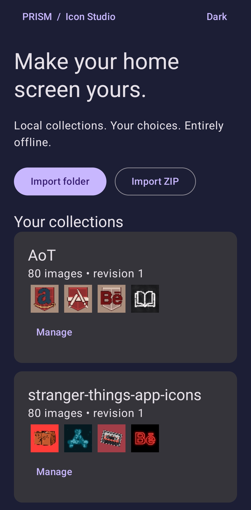
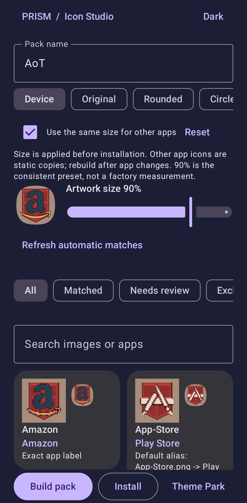
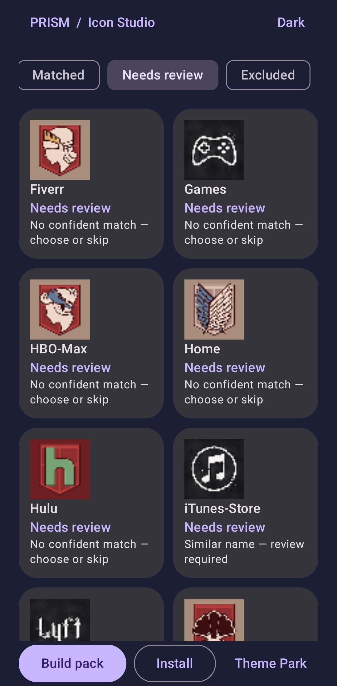
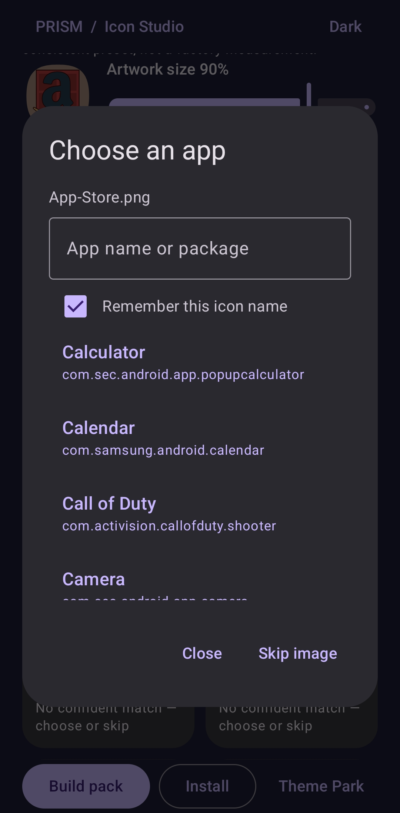
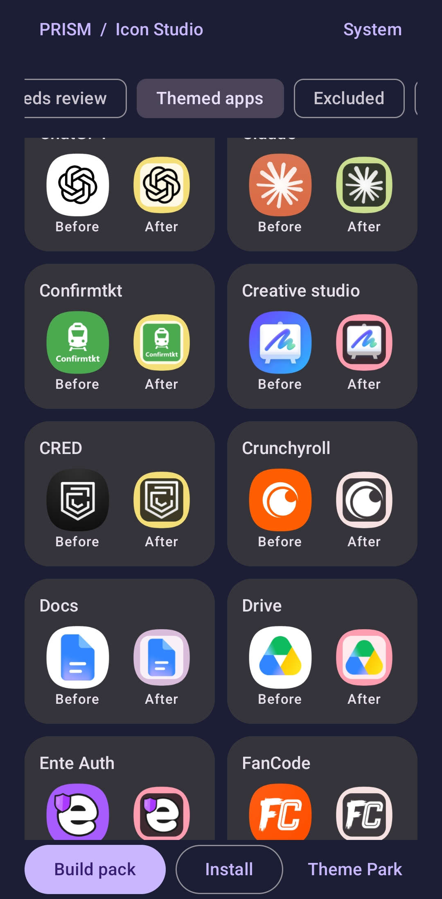

<p align="center">
  
</p>

<h1 align="center">Prism Icon Studio</h1>
<p align="center">Turn your icon collections into Android icon packs, entirely on your phone.</p>
<p align="center"><strong>Android 9+ · Kotlin & Jetpack Compose · Offline · Latest build: 0.13</strong></p>

Prism imports a folder or ZIP of icons, helps you match artwork to installed apps, and builds an installable icon-pack APK on your device. Save collections, remember your choices, and adjust icon shape and size before building.

## Download

**[Download Prism Icon Studio 0.13](delivery/Prism-Icon-Studio-0.13.apk?raw=true)** · [SHA-256 checksum](delivery/SHA256SUMS.txt)

The current signed APK is version `0.13` (version code `13`). On this workstation, previous, preview, test, and unsigned builds are kept in `delivery/archive/`.

Install the APK on Android 9 or later. Android may ask you to allow installation from the app opening the APK. Version 0.12 uses a new signing key, so moving from 0.10 requires uninstalling 0.10 first. Installing later releases over 0.12 with the same signing key preserves existing Prism projects.

## Screenshots

<p align="center">
  
  &nbsp;
  
</p>
<p align="center">
  
  &nbsp;
  
</p>
<p align="center">
  
</p>

App screenshots supplied by the author. Featured icon artwork is credited below.

## What you can do

- Import PNG, JPG/JPEG and WebP images from folders or nested ZIP archives.
- Match icons to installed launcher apps, review ambiguous matches, and search for an app manually.
- Remember icon-name choices across collections; refresh automatic matches without losing manual selections.
- Preview icon shapes and sizes, including the device's adaptive icon mask.
- Preview before and after for apps without artwork. Resize original icons or use **Match this pack** to style them with colors sampled from the current collection.
- Build, sign and install resource-only icon packs on the device.
- Keep multiple saved collections and rebuild them as updates with stable pack identities.
- Use system, light or dark appearance.

Prism requests no Internet permission and requires no account, server or root access. Imported artwork and projects are stored locally.

## Use a collection

1. Download an icon collection to your phone and open Prism.
2. Choose **Import folder** or **Import ZIP**, then select the collection with Android's file picker.
3. Review matches, choose apps for uncertain icons, and enable **Remember this icon name** when useful.
4. Choose a collection name, shape and artwork size. Under **Apps without artwork**, choose **Match this pack**. Prism opens **Themed apps** beside **Needs review**, with searchable before-and-after previews.
5. Tap **Build pack**, then **Install**. If prompted, grant Prism permission to install packages and retry.
6. Select the installed pack in your compatible launcher or theme tool.

For Samsung, open **Good Lock → Theme Park → Icon → Create new**, select the pack, save and apply the theme. After rebuilding a pack, recreate or reselect its theme to refresh applied artwork. Updating Prism itself does not update an already applied theme.

## What's new in 0.10

Remembered artwork now resolves competing icon names more consistently. Explicit project choices take priority, followed by the most recently preferred remembered name. Indistinguishable duplicates still require review. Existing collections can use **Refresh automatic matches** without reimporting.

The remember-choice row is fully tappable and vertically aligned. System Back dismisses the app chooser first; Back from the editor returns to the collection library.

## What's new in 0.13

Prism now appears in its own app picker. **Match this pack** gives the bundled Prism gem a themed background when Prism has no artwork assigned. Open your existing collection and rebuild and install the pack to apply the change in Theme Park.

## What's new in 0.12

**Match this pack** is part of the regular Prism app. To retire the separate preview app on the phone, first recreate any collections you want to keep in Prism, then uninstall **Prism Preview**.

For existing collections, **Refresh automatic matches** updates automatic assignments. Dedicated Google Maps artwork takes priority over a generic Maps icon. With a pack such as Ghibli, `Photos.png` goes to Samsung Gallery. Google Photos appears under **Themed apps** when it has no dedicated artwork. Saved manual choices take priority.

For Gaming Hub, Prism matches both `Game.png` and `Games.png` to the installed Samsung app. In an existing Ghibli collection, use **Refresh automatic matches** or assign `Games.png` in the app picker, then build and install the pack. In Theme Park, use **Create new** and select the rebuilt icon pack before saving and applying it.

## Build from source

Open this repository in Android Studio, or use the included Gradle wrapper.

Requirements:

- JDK 21.
- Android SDK platform 36; Gradle 8.14 is supplied through the wrapper.
- An SDK path in your local `local.properties` file, for example `sdk.dir=/path/to/Android/Sdk`.

```sh
./gradlew :app:assembleDebug
```

On Windows, use `gradlew.bat :app:assembleDebug`. The APK is written to `app/build/outputs/apk/debug/`.

The blank 512-slot resource template is included at `app/src/main/assets/template.apk`; no downloaded icon collection is needed to build the app. To regenerate the template, install Android SDK platform 35 and build-tools 35.0.0, set `ANDROID_HOME` to the SDK, then run:

```sh
python -m pip install -r tools/requirements.txt
python tools/prepare.py
```

Optional `--proof` and `--inventory` flags use local collection folders outside this repository. They are development helpers and are unnecessary for a normal build.

### Release signing

The personal 0.12 release starts a new signing identity for `local.iconstudio`. To build future releases that update that install, run `:app:assembleRelease` without signing variables, then sign the resulting APK with the existing local `secrets/Sign-PrismRelease.ps1` helper.

```powershell
.\secrets\Sign-PrismRelease.ps1 -UnsignedApk .\app\build\outputs\apk\release\app-release-unsigned.apk -OutputApk .\delivery\Prism-Icon-Studio-NEXT.apk
```

The helper verifies the signing certificate before saving the APK. Keep the existing `prism-release.p12` and its password for future releases. The local encrypted password works with this Windows account. For recovery on another machine, back up the keystore and save the password separately in a password manager. The helper's `-CopyRecoveryPassword` option copies the password without printing it.

### Gradle signing configuration

```sh
./gradlew :app:assembleRelease
```

Without signing credentials this produces an unsigned release. To sign your own build, supply these environment variables:

| Variable | Purpose |
| --- | --- |
| `ICONSTUDIO_STORE_PASSWORD` | Required to enable release signing |
| `ICONSTUDIO_KEYSTORE` | Keystore path; defaults to `secrets/release.jks` relative to the project root |
| `ICONSTUDIO_KEY_ALIAS` | Key alias; defaults to `studio` |
| `ICONSTUDIO_KEY_PASSWORD` | Optional separate key password; defaults to the store password |

Keep signing keys and passwords private. A build signed with another key cannot update the published app in place. Generated icon packs use a separate, device-generated Android Keystore key; uninstalling Prism removes access to that key, and key migration is not implemented.

## Project layout

| Path | Contents |
| --- | --- |
| `app/` | Compose UI, import, storage, rendering, pack building and installer integration |
| `core/` | Java matching and compiled Android resource rewriting |
| `tools/` | Template preparation and JVM proof checks |
| `docs/screenshots/` | App screenshots used above |
| `delivery/` | Latest installable app and checksum |

Private keys, machine settings, caches, generated output, personal data, old APKs and compatibility-test APKs are excluded by `.gitignore`. Downloaded third-party icon collections are not bundled.

## Validation and current limits

The local 0.10 development record reports passing Android instrumentation for remembered-choice conflicts, persistence, preference migration and explicit-choice priority, along with release/debug builds, vital lint and APK signature verification. Full Samsung S25 / Theme Park acceptance is still pending; compatibility depends on the launcher or theme tool.

- Packs have a maximum of 512 slots, including original app icons and Prism's own logo entry.
- Clock and calendar artwork is static. SVG, GIF and HEIC import are not supported.
- Project export/import, signing-key migration and background-build recovery are not implemented.
- Importer hardening remains incomplete, including directory-entry quotas and converted-image storage budgets. Use trusted collections while these limits remain unresolved.

Existing developer checks can be run with `./gradlew :app:assembleDebug :app:assembleDebugAndroidTest :app:lintVitalRelease`. The custom instrumentation runner is `local.iconstudio.test/local.iconstudio.ProofInstrumentation`; run it on a disposable emulator after installing the debug and test APKs.

## Credits

Icon collections used during development came from **[Wallpapers Clan](https://wallpapers-clan.com/app-icons/)**. Those icons are not my artwork and belong to their respective creators. Download them from the original site and follow its usage terms. Prism is an independent project and is not affiliated with Wallpapers Clan.

Built with AndroidX, Jetpack Compose and Android apksig; dependencies retain their respective licenses.
